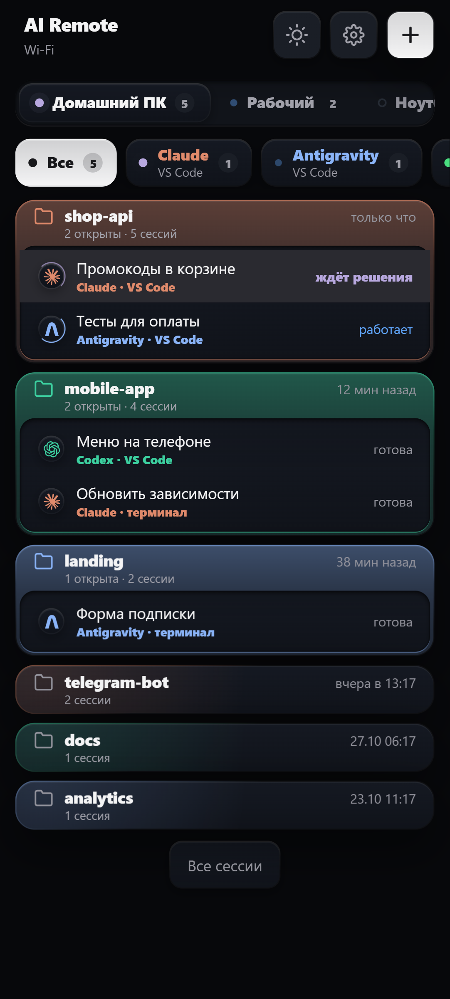
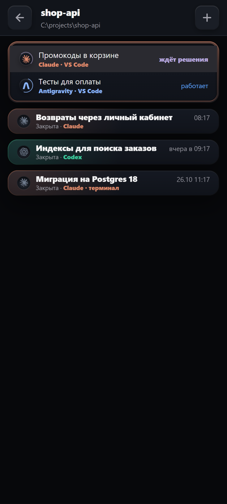
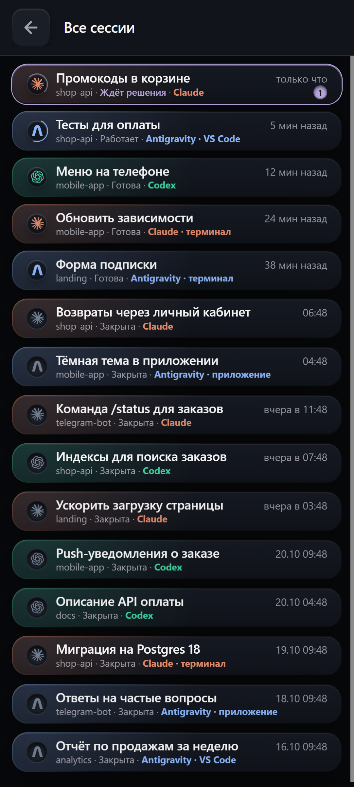
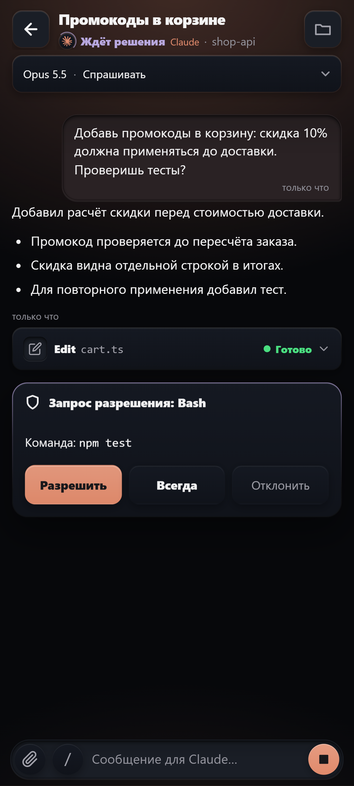
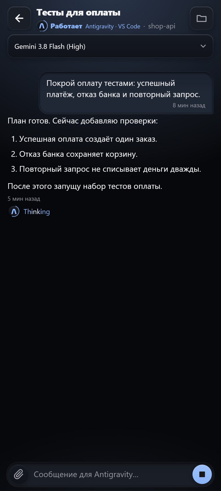
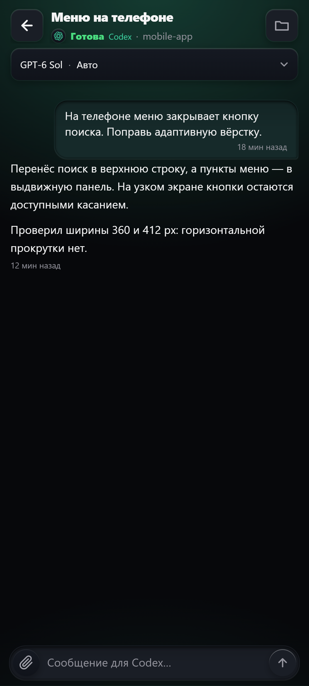
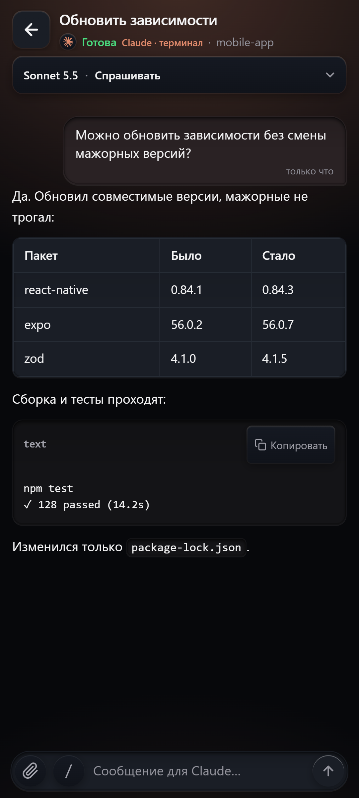
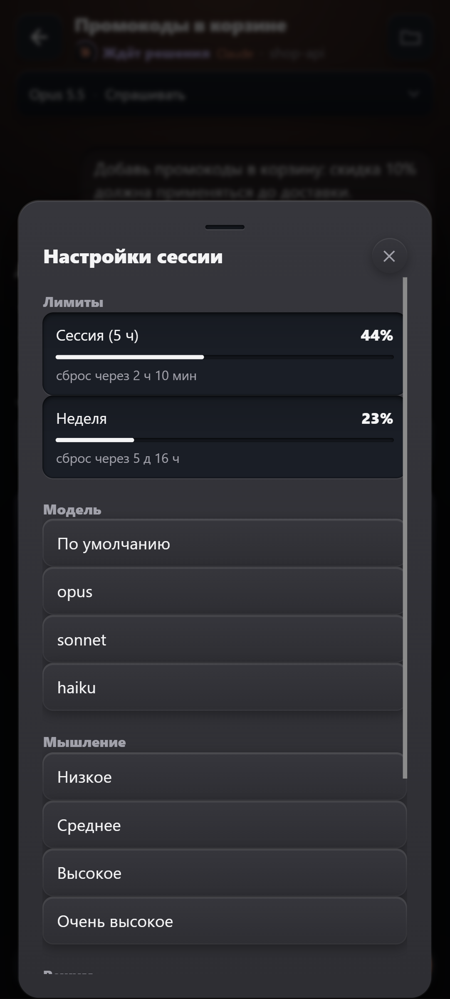
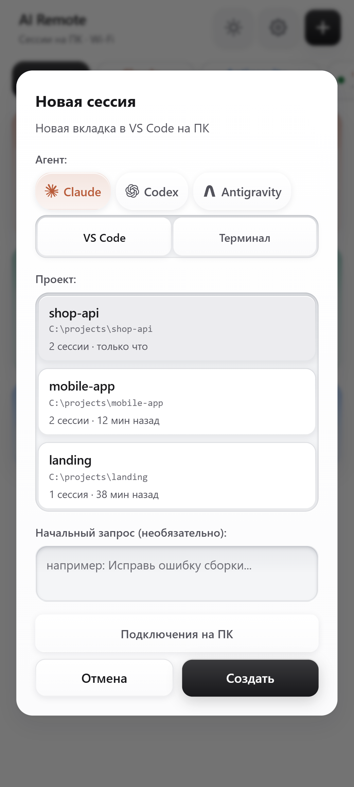

# AI Remote

Сессии ИИ на компьютере у вас в телефоне: Claude Code, Codex и Antigravity — в VS Code, в своих приложениях и в командной строке. Читайте переписку вживую, пишите, отвечайте на запросы разрешений, меняйте модель, открывайте файлы проекта, получайте уведомления. Работает и дома, и через интернет. Свои серверы не нужны.

<table>
  <tr>
    <td align="center"> Несколько ПК, агенты, проекты</td>
    <td align="center"> Проект: открытые и прошлые сессии</td>
    <td align="center"> Все сессии</td>
  </tr>
  <tr>
    <td align="center"> Разрешения — одной кнопкой</td>
    <td align="center"> Antigravity: Gemini, Claude, GPT-OSS</td>
    <td align="center"> Codex</td>
  </tr>
  <tr>
    <td align="center"> Claude в командной строке</td>
    <td align="center"> Модель, режим, лимиты</td>
    <td align="center"> Новая сессия с телефона</td>
  </tr>
</table>

## Установка (5 минут)

**1. Компьютер (Windows 10/11).** Скачайте `AiRemote-Setup-….exe` из [последнего выпуска](../../releases/latest) и запустите.
Windows может показать окно «Система Windows защитила ваш компьютер». Нажмите **«Подробнее» → «Выполнить в любом случае»**. Окно появляется потому, что у программы нет платной подписи издателя.
Галочку «Разрешить телефону подключаться по домашней сети» лучше оставить: Windows один раз попросит права администратора.

**2. Телефон (Android 8+).** В конце установки откроется страница с двумя QR-кодами.
- Наведите камеру телефона на **первый QR-код** и скачайте приложение. Телефон и компьютер должны быть в одной сети Wi-Fi.
- Откройте скачанный файл. Если телефон спросит, разрешите установку из этого источника.

**3. Подключение.** Откройте AI Remote на телефоне и наведите камеру на **второй QR-код**, или введите код с экрана компьютера. Всё готово.

Страницу с кодами можно открыть снова: меню «Пуск» → «Подключить телефон к AI Remote».

## Обновления

Новые версии приходят сами. В настройках приложения появится кнопка «Обновить»: сначала обновляется компьютер, потом приложение на телефоне.

## Удаление

«Параметры Windows» → «Приложения» → AI Remote → «Удалить». Настройки VS Code и командной строки вернутся к прежним.
